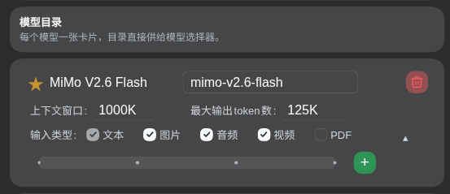
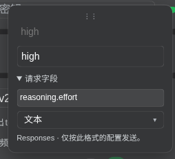

# llm-mimo

MiMo-native LLM adapter plugin for **DSH**（DeepSeek Harness）——为 MiMo CodeX 打造的
模型原生适配器与自定义供应商引擎。接管 `mimo` 主路由，`customProviders` 动态挂载任意
OpenAI 兼容 / Anthropic Messages 端点（百炼、网关、MiMo chat 面等），带**模态硬门禁**与
**提示词源接口**。

## 能力

- **三协议面**：Anthropic Messages（thinking 块/签名 replay/cache_control）、
  OpenAI Chat Completions（SSE、reasoning_content、工具、平行调用）和 Responses
  （SSE、reasoning.effort、原生思考历史、工具结果回传、平行调用）。
- **自定义供应商引擎**：`customProviders` dict 配置即挂载（连接/密钥/目录按路由分线），
  GUI 模型卡片全交互编辑（密钥通道、目录编辑器、连通性探针、GET /models 发现）。
- **多模态真发**：image / audio / video / PDF 内联编码（形状按官方文档 + 裸探针实锤），
  视频抽帧参数（`videoFps`/`videoMediaResolution`）可配。
- **模态硬门禁**：目录勾选=能力声明，未勾的模态**不许进会话**（发送门禁）——静默丢失
  在发送前被明确拒绝取代。
- **llmMimo 提示词接口**：promptbook 等消费方按模型替换**实际使用的**系统提示词与
  工具描述（契约见 [AGENTS.md](AGENTS.md)）。
- **模型选择与思考控制**：供应商默认星标、悬浮细滑轨与逐模型、逐 API 格式档位编辑；
  原生 DeepSeek/pi-ai 模型也以滑轨展示适配器公布的档位。

## 能力矩阵（裸探针实锤，2026-09-28）

| MiMo 面 | image | audio | video | PDF | 平行工具 |
|---|---|---|---|---|---|
| `/anthropic` | ✓ | ✗ 静默丢 | ✗ 静默丢 | ✗ 静默丢 | ✓ |
| `/v1` chat | ✓ | ✓ | ✓ | 400 明拒 | ✓ |
| `/v1` responses | ✓ | ✓ | ✓ | 400 明拒 | ✓ |

（第三方端点各异：百炼 qwen3.8-max 支持 image/video/PDF；勾选以实测为准。）
矩阵中的 Responses 是当时的裸 API 探针结果；插件传输于 2026-10-11 接入，
验证记录见 [Responses 验证](log/model-effort-selector/mimo-responses-verification.md)。

## 安装

### 一、装插件（GUI，dsh 0.2.0-rc.1+）

桌面版：**插件 → 添加插件** → 粘贴本仓库本地路径（或 GitHub 地址 / npm 包名）→ 安装 →
立即启用 → 彻底重启。peerDependencies 已声明 `0.1.7-rc.2 || 0.2.0-rc.1 || 0.2.0-rc.2`，安装器兼容
门禁直接放行，无需任何命令行。

### 二、宿主补丁（多模态真发 + 设置页第三页签）

适配 **dsh 0.2.0-rc.1 / 0.2.0-rc.2**（npm 面两版宿主文件逐字节一致，补丁同一份）。补丁替换两个宿主文件（dsh-llm 投影层按模态勾选保留
image/audio/video/PDF file 块；设置页模型添加对话框增加「自定义模型 API (llm-mimo)」
页签）。脚本**只处理你所在的根目录**，绝不全局扫描；哈希校验版本，不符即拒绝，可反复
执行，卸载完全可逆。

**桌面版**（cd 到安装根，或其 `resources` 子目录）：

```powershell
cd "$env:LOCALAPPDATA\Programs\DeepSeek Harness"
irm https://raw.githubusercontent.com/dalizi2333/dsh-llm-mimo/main/patches/remote-patch.ps1 | iex
```

**HDSL / 任意运行时形态**（cd 到数据根、数据根下 `runtimes`、或任意含
`node_modules/@deepseek-ai/dsh-llm` 的目录）：

```bash
cd /d/某处/HDSL数据目录/runtimes
curl -fsSL https://raw.githubusercontent.com/dalizi2333/dsh-llm-mimo/main/patches/remote-patch.sh | bash -s -- install
```

卸载 / 状态：

```bash
curl -fsSL https://raw.githubusercontent.com/dalizi2333/dsh-llm-mimo/main/patches/remote-patch.sh | bash -s -- uninstall
curl -fsSL https://raw.githubusercontent.com/dalizi2333/dsh-llm-mimo/main/patches/remote-patch.sh | bash -s -- status
```

（PowerShell 卸载/状态：`$env:DSH_PATCH_MODE="uninstall"` 或 `"status"` 后再 `irm | iex`。
国内网络 raw 不通时，把两个域名的 `raw.githubusercontent.com/dalizi2333/dsh-llm-mimo/main`
换成 `cdn.jsdelivr.net/gh/dalizi2333/dsh-llm-mimo@main` 即可——推送后 jsDelivr 缓存有
分钟级延迟。）

离线场景可双击 `patches/install-desktop-host-patch.cmd`（桌面版专用，同一逻辑）。
注意：桌面版升级后宿主被覆盖，重跑一次装载即可；卸载 = 删 `resources\app` 并把
`app.asar.unpatched` 改名回 `app.asar`。

### 三、手动四件套（开发者，dsh 0.1.x / 自定义 profile）

包放入 `profiles/<name>/packages/llm-mimo`，`package.json` 加
`"@mimo-codex/dsh-llm-mimo": "link:./packages/llm-mimo"` 依赖与 `dsh.profile.bundles`
条目（有序、放基础 bundle 之后），`node_modules/` 建链接。宿主补丁可直接重放：

```bash
python patches/apply_host_patches.py <dsh运行时的node_modules目录>
```

## 配置

### 在模型配置页自定义思考强度滑杆

在 **设置 → 模型** 中编辑 llm-mimo 托管的供应商，即可为它的每个模型配置滑轨档位。
MiMo 主供应商和通过「自定义模型 API (llm-mimo)」添加的供应商都支持此操作。
**「默认」始终不发送任何思考参数，包括是否关闭思考的开关。**

#### 找到滑轨与 API 格式

1. 点击供应商右侧的 **编辑**，打开该供应商的配置。
2. 在 **Base URL** 行左侧悬浮，标签会显示当前 API 格式；点击标签区域，在弹出的卡片里
   选择 **OpenAI Chat Completions / Anthropic Messages / OpenAI Responses**，并确认对应地址。
3. 在模型目录中悬浮模型行，点击出现的展开箭头。展开后的 **输入类型** 下方就是强度滑轨，
   右侧的绿色 **+** 用于添加档位。



*图中为 MiMo V2.6 Flash 的 Responses 配置；四个点从左到右是关闭思考、默认、low、high。*

每个模型的三个 API 格式分别保存自己的档位、名称、值、请求字段和值类型。
切换格式时滑轨会一起切换，切回原格式会恢复原配置；修改一个模型不会改动其他模型。
尚未配置的格式从「关闭思考 / 默认」两点开始，不借用另一格式的参数。

#### 添加、编辑和保存档位

1. 点击滑轨右侧的绿色 **+**，增加一个普通档位，并自动聚焦其必填的 **强度值**。
   编辑已有档位时，悬浮对应的点即可弹出编辑卡。
2. 在卡片顶部编辑 **强度显示名**。它默认没有边框，留空时显示名跟随强度值；
   可以把值为 `high` 的档位命名为「高」，名称只用于界面显示。
3. 在完整边框的 **强度值** 输入框中填写实际发送给 API 的值，例如 `high`、`4096`，
   或一个 JSON 对象。新增档位不能留空。
4. 展开 **请求字段**，填写端点要求的字段路径，再在下方的浮层下拉中选择值类型。
   字段路径使用点号表示嵌套，例如 `reasoning.effort` 会生成 `{"reasoning":{"effort":值}}`。
5. 编辑完成后点击 **供应商配置底部的保存**。点选、输入和拖动都只改变草稿；
   点击 **取消** 会丢弃尚未保存的配置。



*图中强度显示名留空，因此跟随 `high`；请求字段为 `reasoning.effort`，值类型为「文本」。*

**名称和值按档位分别设置；普通档位的请求字段和值类型则由当前模型、当前 API 格式共用。**
例如把 high 卡片的字段改为 `reasoning.effort`，同一滑轨里的 low 等普通档位也会使用
这个字段，但各自的名称和值保持不变。「关闭思考」使用独立的请求字段和值。

| 下拉选项 | 强度值如何发送 | 示例 |
|---|---|---|
| 自动解析数字 / JSON，否则文本 | 有效 JSON 按其类型发送，其他内容保留为文本 | `4096` → 数字，`false` → 布尔值，`high` → 文本 |
| 文本 | 始终发送字符串 | `4096` → `"4096"`，`high` → `"high"` |
| 数字 | 转为有限数字，无法转换时不能保存 | `4096` → `4096` |
| JSON | 必须是有效 JSON，可发送对象、数组或其他 JSON 值 | `{"type":"enabled","budget_tokens":4096}` → 对象 |

保存会检查全部已配置的 API 格式。若强度值为空、字段路径无效或值类型不匹配，
会定位对应档位；错误在其他格式里时，也会自动切到那个格式供修改。

#### 排序与删除

在普通档位的点、卡片顶部拖动标记或卡片空白处短暂长按（约 200 ms），即可进入拖动。
也可以按下后直接移动。拖动时卡片和点跟随鼠标，右侧绿色 **+** 变成红色垃圾桶：

- 拖到其他普通档位之间，松手后改变顺序；滑轨上的所有点会重新均分间距。
- 拖到红色垃圾桶上松手，删除该档位。
- 按 **Esc** 取消本次拖动。输入框、请求字段展开按钮和值类型下拉用于编辑，不作为拖动把手。

键盘操作：聚焦普通档位后，**Alt + 左/右方向键** 调整顺序，**Delete** 删除该档位。

#### 关闭思考与默认

| 特殊档位 | 位置与编辑方式 | 请求行为 |
|---|---|---|
| 关闭思考 | 始终是最左侧的点，不能拖动或删除；悬浮打开卡片，编辑名称、关闭值与独立请求字段 | 发送配置的关闭字段和值 |
| 默认 | 始终紧邻关闭思考的右侧，不能拖动或删除 | 完全不传思考参数，也不传关闭开关 |

这两个点的位置也参与均分：增加普通档位后，它们之间的距离会缩小。
关闭项初始为 Chat / Messages 的 `thinking.type: disabled`，或 Responses 的
`reasoning.effort: none`，可按端点实际要求修改。关闭值按「自动解析」处理，例如
`disabled` / `none` 为文本，`false` 为布尔值。选择「默认」不会发送卡片里显示的 `0`。

#### 配置示例

以下展示字段、类型和值怎样组成请求片段。按所用端点支持的参数配置滑轨；
档位名称和顺序由使用者决定，插件不会自动推断 token 预算。

| 普通档位的请求字段 | 值类型 | 卡片中的强度值 | 发送的思考参数片段 |
|---|---|---|---|
| `reasoning.effort` | 文本 | `high` | `{"reasoning":{"effort":"high"}}` |
| `reasoning_effort` | 文本 | `high` | `{"reasoning_effort":"high"}` |
| `thinking.budget_tokens` | 数字 | `4096` | `{"thinking":{"budget_tokens":4096}}` |
| `thinking` | JSON | `{"type":"enabled","budget_tokens":4096}` | `{"thinking":{"type":"enabled","budget_tokens":4096}}` |

例如要配置 Responses 的 low / high，添加两个普通点，分别填值 `low`、`high`；
在任一普通点中把请求字段设为 `reasoning.effort`，值类型选 **文本**，再保存。
若端点需要同时发送思考开关和预算，可使用表格最后一行：字段填 `thinking`，
值填其中的对象，不要再把整个请求包进强度值。
思考映射不能覆盖模型 ID、消息、工具或输出上限等请求字段。

插件自带的 MiMo V2.6 Flash、Pro、Pro Ultraspeed 目录包含以下预设，默认选择均为不传参：

| API 格式 | 滑轨从左到右 | 显式档位的请求字段 |
|---|---|---|
| Chat Completions | 关闭思考（`disabled`）/ 默认 / 开启思考（`enabled`） | `thinking.type` |
| Anthropic Messages | 关闭思考（`disabled`）/ 默认 / 开启思考（`enabled`） | `thinking.type` |
| Responses | 关闭思考（`none`）/ 默认 / `low` / `high` | `reasoning.effort` |

预设仅提供参数映射，不保证不同名称对应不同 token 预算或服务端行为；
MiMo 的参数含义见 [Responses 官方说明](https://mimo.mi.com/docs/zh-CN/api/chat/responses)。
已有模型目录，以及使用者自行修改或删除的档位，不会被预设覆盖或自动回填。

### 默认模型与对话框中的滑轨

在设置页模型名字左侧悬浮，可点击空心星设为供应商默认模型；被选中的模型显示常驻实心星。
展开和收起时都可操作，没有手动指定时使用目录第一项。

对话框点击模型名称打开供应商列表，点击供应商名称选其默认模型，点击右侧悬浮箭头
展开该供应商的模型目录。悬浮当前模型或目录中的模型，会出现配置好的强度滑轨；
移动到滑轨上可以继续操作。悬浮手柄查看当前档位，悬浮其他可选点预览其名称和值，
点选或拖动手柄选择档位。点击模型名称用于切换模型。

llm-deepseek / llm-pi-ai 模型也可以使用这个滑轨，但它们的选项来自各自适配器公布的
能力目录，不通过上述 llm-mimo 模型配置页自定义。它们的默认点恢复适配器默认档位，
不支持关闭的模型没有关闭点；请求转换仍由原适配器负责，原生默认不承诺省略请求参数。
切换模型不会沿用另一模型的档位；已删除的当前档位会显示提示，重新选择后恢复。
新交互在 DSH 0.2.0-rc.2 验证，旧宿主缺少选模服务时保留既有设置功能。

### 配置文件与开发

GUI 将上述配置保存到每个模型的 `reasoningControlsByFormat`，按 `chat`、`anthropic`、
`responses` 分开存储。旧单份 `reasoningControls` 在编辑时归到原格式；旧 `thinking`
配置保留读取兼容，但不再自动注入请求，标题请求也不再强制发送关闭开关。

`cordis.patch.yml` 的 `llm-mimo` 行 config：`apiKeyEnv`/`baseURL`/`apiFormat`/
`modelsJson`（模型目录：id/name/contextWindow/maxTokens/inputModalities/videoFps/
videoMediaResolution/reasoningControlsByFormat）/`defaultModelId`（供应商默认模型）/
`customProviders`（dict：displayName/apiKeyEnv/baseURL/apiFormat/modelsJson/defaultModelId）/
`dispatchViewJson`（volatile 遥测：最近 dispatch 的实际 system 视图环形缓冲，勿手写）。
完整契约见 [AGENTS.md](AGENTS.md)。

Responses 请求走当前 Base URL 下的 `/responses`，MiMo 根地址使用
`https://api.xiaomimimo.com/v1`。原生 reasoning item、工具 call_id 与工具结果回传到
下一轮，仅在同一模型和路由复用原生 replay；输出上限映射为 max_output_tokens，
输入映射为 input。Responses 不支持 stop 序列，显式设置时拒绝发送。

开发时修改 `lib/model-controls.js` 或 `src/controls-client.js` 后运行 `npm run build:client`，
生成 `lib/client.js` 的标记区域。`npm run ci` 检查产物一致性、请求回归、原生适配器强度
兼容、安装门禁与现有宿主补丁重放。

## 文档

- [AGENTS.md](AGENTS.md) —— 暴露接口契约、配置面、门禁语义、开发与部署纪律
- [默认模型与思考强度控制](log/model-effort-selector/handover.md) —— 实现、部署和验证记录
- [log/llm-mimo/](log/llm-mimo/README.md) —— 开发计划归档（`handover.md` 交接入口、进度、决策、探针基线与踩坑）
- [log/llm-mimo/rp-efficiency-experiment-2026-10.md](log/llm-mimo/rp-efficiency-experiment-2026-10.md) —— 实验记录：RP 人设强化 deepseek-flash Agent 的效率效应（质量不变、token 1/4~1/11；含可复用人设模板与注入可达面大坑）

## 许可证

[MIT](LICENSE) © 2026 MiMo CodeX
