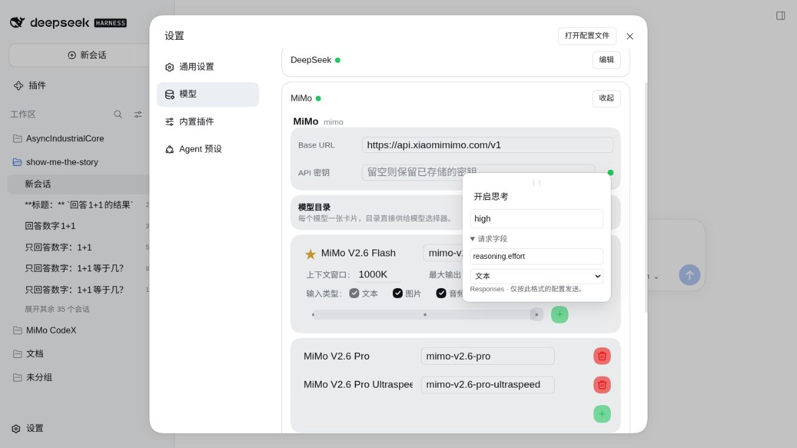

// SPDX-License-Identifier: CC-BY-4.0
<!-- Copyright (c) 2026 MiMo CodeX / dalizi233 -->

# MiMo 预设验收，2026-10-11

用户授权为 MiMo V2.6 Flash、Pro、Pro Ultraspeed 预设逐 API 格式思考配置。
DSH 基线仍为 0.2.0-rc.2，插件仍为 0.4.1。没有提交、推送或发布。

## 官方能力与预设

三模型目前使用相同思考开关能力。Chat / Messages 支持 enabled / disabled；
Responses 接受多个 effort 枚举，但官方明确非 none 值行为相同，尚不能调节投入。
因此不填虚构 token 预算或多组等价的强度档，均预设关闭 / 默认 / 开启。

| 格式 | 关闭 | 默认 | 开启 |
|---|---|---|---|
| [Chat Completions](https://mimo.mi.com/docs/zh-CN/api/chat/openai-api) | thinking.type: disabled | 全部思考字段省略 | thinking.type: enabled |
| [Anthropic Messages](https://mimo.mi.com/docs/zh-CN/api/chat/anthropic-api) | thinking.type: disabled | 全部思考字段省略 | thinking.type: enabled |
| [Responses](https://mimo.mi.com/docs/zh-CN/api/chat/responses) | reasoning.effort: none | 全部思考字段省略 | reasoning.effort: high |

仅插件自带 DEFAULT_MODELS 写入预设；九个普通点使用预先生成的独立稳定 UUID。
已有保存目录、显式空桶、用户手动编辑/删除、自定义端点都不自动回填。当前实例
九份原先为空的配置是本轮通过 GUI 明确填写；GUI 创建的 UUID 与自带预设不同，
保存、切换格式和重启后都稳定。供应商默认仍为 Flash。

## 验证

- 完整 npm run ci 退出 0：14 项历史/控制回归、2 项真实基线原生适配器兼容、生成
  一致性、安装门禁、pristine 补丁重放/幂等、临时官方安装及组合树通过。
- 新增回归覆盖三模型 × 三格式的字段/值、默认省略、关闭、开启、九个稳定 ID，
  Chat / Messages 实际适配器序列化；Responses 仍明确拒绝 UNSUPPORTED_FORMAT。
  保存编辑、显式删除、缺失桶、自定义同名模型保留，不以 stock 预设覆盖。
- 真实 1280×720 GUI：逐模型切换三格式、编辑卡字段/值恢复、保存与重启后九桶对账。
  [编辑卡记录](mimo-preset-ui.json)、[保存后配置](mimo-presets-config.json) 仅含公开模型元数据。

同一 Flash、同一“只回答数字：1+1等于几？”任务，从 GUI 选择后真实发送：

| 格式 | 档位 | 实际请求中的思考字段 | GUI 结果 |
|---|---|---|---|
| Chat | 开启 | thinking.type: enabled | 已完成，2 |
| Chat | 默认 | 全部省略 | 已完成，2 |
| Messages | 开启 | thinking.type: enabled | 已完成，2 |
| Messages | 默认 | 全部省略 | 已完成，2 |

[安全出站记录](mimo-preset-wire.jsonl) 每个 case 有任务和自动标题两个请求，均 HTTP
200；开启 case 只有主任务携带 enabled，默认 case 两请求都不含任何思考字段。
观察器只记录模型、路径、配置字段与状态，不记录请求正文、工具、头、凭据。
DSH 会包装任务文本，原先原始文本完全相等判定无效，未用该布尔值区分主请求；证据
按一次 GUI 发送的 case 窗口归组，任务完成结果由 GUI 核验。

本轮未向 MiMo Responses 发请求：本插件该格式传输尚未接入。三模型的实际远程
调用只抽验 Flash；其余模型预设经过 GUI 配置与序列化回归，没有宣称三模型均远程验收。

## 交付状态

当前实例恢复起始 Responses 格式与 URL，会话选择为 Flash / 默认。两个 profile
六个复制包文件逐字节一致；去掉临时观察器后干净重启，llm-mimo v0.4.1 组件运行中。
保留四个验证会话和预览，API 凭据及认证 token 没有写入这些证据文件。

