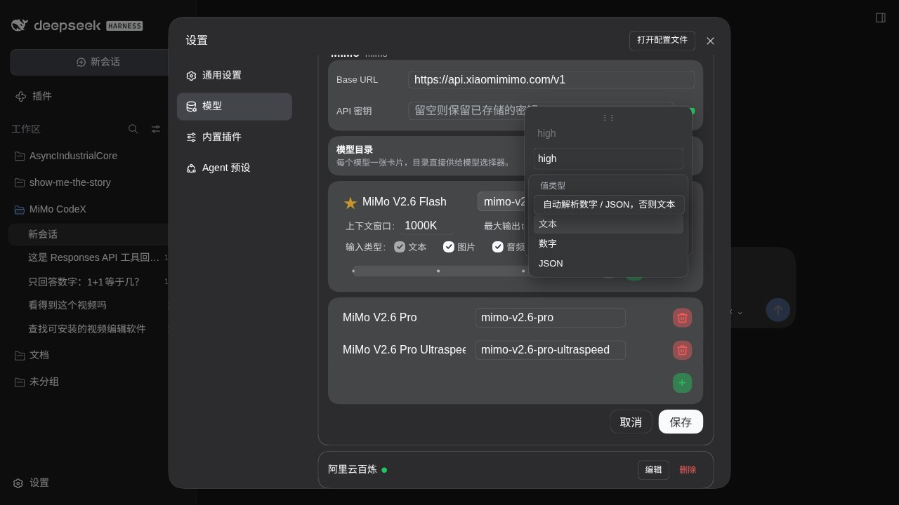
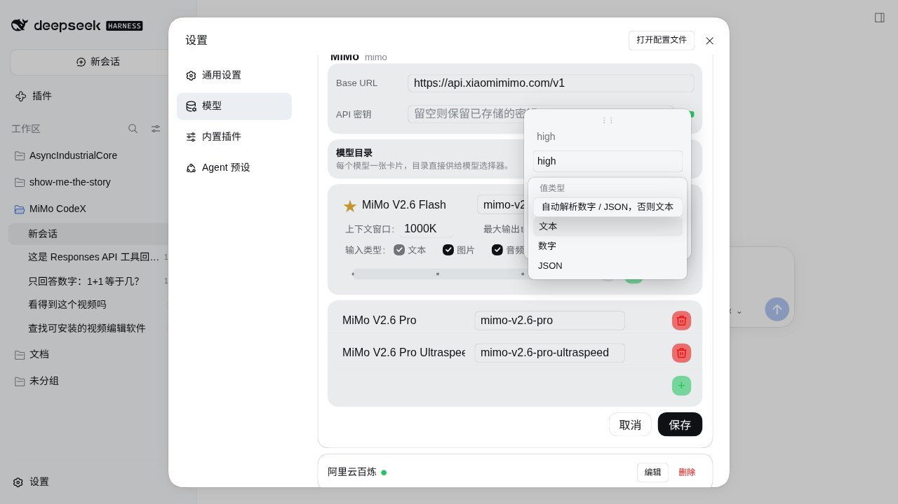

// SPDX-License-Identifier: CC-BY-4.0
<!-- Copyright (c) 2026 MiMo CodeX / dalizi233 -->

# 值类型浮层下拉验证

日期：2026-10-11。DSH 0.2.0-rc.2，实例 mimo-codex-020rc2 / core-web，
页面 http://127.0.0.1:38375/，渲染视口 1280 × 720 CSS px。

## 修改

强度编辑卡「请求字段」下的值类型原为系统原生 select。改为插件自身的浮层组件，
沿用 Promptbook 的样式和交互：当前选项在触发器原位置打开，条目悬浮时浮成独立卡，
浮层进入与退出均为 200 ms，条目 padding 过渡 260 ms。未添加对 Promptbook 的运行时依赖。
保留 auto / string / number / json 四种配置值，名称及映射语义不变。

浮层复用宿主背景、文字、边框和日夜阴影令牌，挂到 portal 避开设置抽屉裁切。
编辑卡的外部点击、离焦和 Escape 边界包含该浮层，选择不会关闭编辑卡；
拖动期间禁用触发器并关闭浮层，避免拖动时留下脱离编辑卡的菜单。

## 实际验证

- MiMo V2.6 Flash / Responses / high：点选 JSON，箭头导航到数字并回车选中，
  再点选自动解析、文本；每次均更新触发器文字，菜单退出后编辑卡保持打开。
- ArrowDown 从触发器打开并聚焦已选项；ArrowUp 导航、Enter 选择通过。
- Escape 只关闭内层值类型菜单，编辑卡保留；点请求字段输入框也只关闭菜单。
- 深色：浮层背景 rgb(53, 54, 56)，文字 rgb(249, 250, 251)，阴影 alpha .4。
  浅色：背景 rgb(245, 246, 247)，文字 rgb(15, 17, 21)，阴影 alpha .18。
- 悬浮条目有独立边框和阴影，padding / 背景过渡为 .26s / .15s。
  已选行与触发器顶端差约 -0.33 px；强度编辑卡内不再存在原生 select。
- 两轮测试草稿均通过「取消」丢弃；重新打开回读文本类型。恢复原深色主题，
  当前对话模型仍为 Qwen3.8-Max，最终保留未修改的 high 编辑卡与下拉供用户查看。
- 本轮未保存模型配置、未请求上游模型。

## 构建和部署

修改 src/controls-client.js，经 npm run build:client 生成 lib/client.js。
core-web / core-headless 的 llm-mimo 副本均同步；7 个部署文件逐字节一致。
指定基线 DSH_RUNTIME_BIN 后 npm run ci 退出码 0：23 + 2 项回归及安装/补丁门禁通过。
CI 日志：/tmp/mimo-value-type-dropdown-ci.log。运行中的服务无需重启。

## 页面证据

